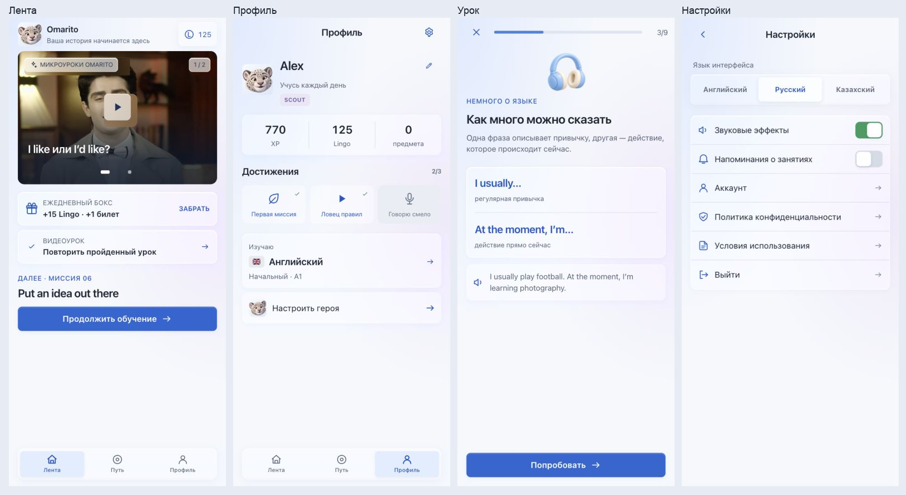
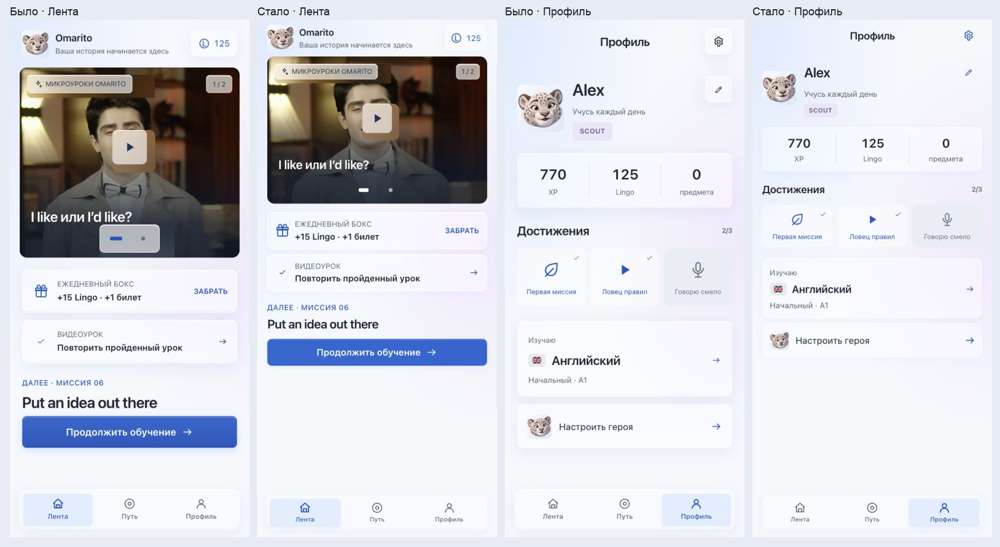

# Omalingo — светлый Liquid Glass

Дата проверки: 9 ноября 2026 года.

Все 23 страницы переведены на общую светлую систему. Сохранены маршруты, порядок обучения, выбор языка, прогресс, награды и действия пользователя. Навигация и управляющие панели используют полупрозрачный материал; учебный текст расположен на спокойных светлых поверхностях.

## Реализация

- Системный шрифт Apple на iOS/macOS, системный sans-serif на остальных платформах. Удалена загрузка Google Fonts и декоративный serif.
- Цвет текста `#1d2633`, вторичный текст `#596578`, акцент `#1457c5`, базовый фон `#f6f8fc`.
- Стекло: белая заливка 28% для управления, 40% для карточек, `blur(18px) saturate(155%)`, светлый край и мягкая контактная тень. Для диалогов, уведомлений и управляющих кнопок поверх видео заливка 64%.
- Основная кнопка: однотонная синяя заливка 94%, высота от 44 px. Кнопки с иконками — 44 px, плавающая панель вкладок — 56 px.
- Единый набор SVG-иконок с толщиной линии 1.7. Эмодзи в интерфейсе заменены; предметы учебных заданий и изображения флагов сохранены как содержание.
- Добавлены видимый фокус, обозначение текущей вкладки и выбранного варианта, именованные диалоги с удержанием и восстановлением фокуса, закрытие по Escape.
- Учтены safe area, динамическая высота окна, уменьшение движения, уменьшение прозрачности, повышенная контрастность и отсутствие поддержки backdrop-filter.
- Светлые фон WebView, системное оформление iOS и три стартовых изображения.

Это реализация визуального стиля средствами React/CSS внутри Capacitor. Оптический рендерер нативного SwiftUI Liquid Glass здесь не используется. Принцип разделения материала управления и содержимого опирается на [Apple HIG: Materials](https://developer.apple.com/design/human-interface-guidelines/materials).

## Компактная плотность — редакция 1.3

- Заголовки страниц и вопросов 20–22 px, секции и навигация 17 px, основной текст 14–15 px. Приветствие и имя мира сохраняют акцент 28 px; поля ввода 16 px.
- Основные действия 44 px вместо 52 px; настройки 52 px вместо 65 px; миссии 60 px вместо 78 px; панель вкладок 56 px вместо 66 px. Зоны нажатия кнопок не меньше 44 px по высоте.
- Боковые отступы 16 px, внутренние отступы большинства карточек 10–14 px. Уменьшены иллюстрации, аватары, награды, видео и поля для практики.
- Навигационные кнопки получили простые синие иконки без отдельной стеклянной плитки. Убраны выраженные тени карточек, градиент основного действия и большая подложка переключателя видео.
- Повторно просмотрены все 23 страницы при 390 × 844; 69 проверок страниц на EN/RU/KK при 320 × 568 — без горизонтального переполнения и кнопок ниже 44 px. Ещё 69 проверок шагов — без переполнений и недостижимых кнопок.
- Стекло и небольшие прямоугольные скругления сохранены. Масштаб браузера и CSS zoom не используются для уменьшения интерфейса.

## Предыдущее уточнение типографики, прозрачности и формы — редакция 1.2

- Заголовки приведены к насыщенности 600, межбуквенный интервал ослаблен; основные размеры 20–34 px. Текст 400, второстепенные метки 500, выделения и кнопки 600. Добавлена оптическая настройка системного шрифта.
- Капсулы и круглые элементы управления заменены прямоугольниками: радиусы 6/8/10/12 px. Это касается навигации, карточек, полей, выбора ответа, категорий, сообщений, переключателей и диалогов. Круглая форма осталась только у световых ореолов и индикаторов загрузки.
- Более прозрачный материал применяется к карточкам, полям и учебным панелям. Фон проходит через поверхность, а размытие сохраняет читаемость текста.
- Исправлено распространение размытия карточки наставника на следующий заголовок: материал ограничен контуром карточки.
- Во встроенном браузере обнаружено активное `prefers-reduced-transparency: reduce`. Обычное приложение продолжает учитывать эту настройку. Для независимой проверки обычного материала добавлен **только в dev review** параметр `material=clear`; он не меняет системные настройки и отсутствует как пользовательский переключатель в production.
- Повторно просмотрены 23 экрана при 390 × 844. Выполнены 69 проверок страниц и 69 проверок многошаговых экранов при 320 × 568 на EN/RU/KK; горизонтальных переполнений текста и контролов не найдено.

## Проверка по страницам

| Страница | Изменения и проверка |
| --- | --- |
| `welcome` | Светлая иллюстрация, системная типографика, стеклянный выбор языка, один основной CTA. Устранён выход иллюстрации за край на 320 px. |
| `language` | Светлые строки выбора, чёткое выбранное состояние, доступный переход дальше. |
| `personalize` | Читаемое поле имени и три варианта цели; обязательные поля сохранены. |
| `starting` | Два компактных варианта с едиными иконками; удалён повтор названия курса. |
| `level-check` | Все пять заданий, обычное и выбранное состояния, аудиоподсказка и диалог выхода. |
| `recommendation` | Компактная рекомендация NOVA и светлое состояние ожидания. |
| `starter` | Светлая панель вопроса, правильный и неправильный ответы, доступная прокрутка. |
| `intro` | Удалены повторный надзаголовок и необязательная нижняя подпись. Предпросмотр первой миссии сохранён. |
| `hero` | Все четыре шага, стеклянная панель категорий, светлая сетка вариантов и выбранные состояния. Механика сборки персонажа не перерабатывалась. |
| `feed` | Стеклянные элементы поверх видео, плавающие вкладки, один заголовок следующей миссии. Убраны дублирующая приветственная фраза и счётчик «дневного плана», который фактически считался за всё время. |
| `journey` | Светлый список миров и единые значки блокировки; убрана повторная сводка прогресса под списком. |
| `world` | Четыре уровня и фактический прогресс; удалены произвольные показатели `+12%…+30%`. |
| `level` | Фактический счётчик завершённых миссий, компактные строки, наставник и босс. Убраны фиктивные проценты незавершённых заданий и декоративный ряд медалей. |
| `lesson` | Все девять шагов, ввод текста, самопроверка, продолжение разговора, перенос навыка, результат и выход. Запись, готовая запись и недоступное медиа проверены визуальными фикстурами. |
| `short-lesson` | Все пять шагов видеоурока: видео, вопрос, правило, собственный ответ, награда. Пройден сценарий с текстовым ответом и возвратом в ленту. |
| `conversation` | Светлые сообщения и стеклянная панель ввода, проверка ответа, коррекция и награда. Добавлена прокрутка к последнему сообщению. |
| `boss` | Три вопроса и итоговая награда; пройден сценарий правильных ответов до результата. |
| `profile` | Компактная статистика, единые иконки достижений. Убраны фиксированный «уровень 3» и фиктивные 40%. Длинное имя ограничено двумя строками; полностью доступно в редактировании. |
| `edit-profile` | Светлое поле, ошибка пустого имени, сохранение и отмена. Удалена неработавшая декоративная кнопка изменения аватара. |
| `language-select` | Выбор языка без выдуманных 15%/40%; устранён повтор заголовка в панели навигации. |
| `settings` | Стеклянный переключатель языка, системные переключатели, единые иконки строк, светлый диалог выхода. |
| `account` | Светлая карточка аккаунта и диалог удаления; выделение опасного действия красным сохранено. |
| `store` | Удалены рекламный заголовок и повтор баланса. Товары представлены читаемыми строками. Экосистема раскрывается по запросу; общий маркер предпросмотра заменяет шесть одинаковых подписей. Уведомление видно поверх текущей позиции прокрутки. Сезон обозначает прогресс, а не выдуманное число дней. |

Дополнительно проверено состояние загрузки прогресса. Нативные стартовые изображения используют тот же светлый фон.

## Выполненная проверка

- Встроенный браузер, размер 390 × 844: визуальная проверка всех страниц и шагов уроков, теста уровня и персонажа.
- Размер 320 × 568: 23 страницы × EN/RU/KK = 69 проверок переполнений и достижимости элементов управления. Найденный выход иллюстрации исправлен и перепроверен.
- На том же размере: 23 шага многошаговых экранов × EN/RU/KK = ещё 69 проверок. Горизонтальных переполнений и недостижимых кнопок не найдено.
- Отдельно проверены длинное имя, ошибка формы, раскрытая экосистема, уведомление магазина, диалоги настроек и аккаунта, клавиатурный фокус и Escape.
- Пройден путь «Лента → Путь → NOVA → уровень 2 → миссия → выход → Профиль → Настройки».
- Контраст основных токенов: основной текст 14.34:1, вторичный текст 5.55:1, белый текст на самом светлом крае основной кнопки 5.00:1. Это проверка пар цветов, не сертификация каждого видеокадра.
- `pnpm run build` и `pnpm run ios:build`: успешно. Проверена сборка Debug для iOS Simulator без подписи.
- Проверка JavaScript-консоли: ошибок в просмотренных сценариях нет. Контролы режима проверки исключены из production JS.
- `git diff --check`: без ошибок.

Физические iPhone/Android, системная клавиатура телефона и реальная запись микрофона в эту визуальную проверку не входили. Состояния записи проверялись на тестовых данных. Покупки, аккаунт и учебное содержание не получают новую серверную функциональность от смены оформления. Vite сохраняет предупреждение о большом общем JS-бандле; сборка проходит.

## Как повторить просмотр

Запустить `pnpm dev` и открыть [галерею страниц](http://127.0.0.1:5173/?design-review). Выбор экрана и шага находится вне рамки приложения. Данные прогресса в этом режиме тестовые: серверный клиент не создаётся, сохранение прогресса выключено.

Для отдельного мобильного экрана: `/?design-review&canvas&screen=feed&locale=ru`. Поддерживаются `locale=en|ru|kk`, `step=0…8` в пределах выбранного потока. В уроке можно показать `state=recording`, `state=recorded` и `state=media-error`. Обычный адрес `/` открывает приложение с сохранённым прогрессом пользователя.

Для проверки обычного прозрачного материала при включённом системном уменьшении прозрачности: `/?design-review&canvas&screen=profile&locale=ru&material=clear`. Без `material=clear` предпросмотр учитывает настройки доступности системы.
